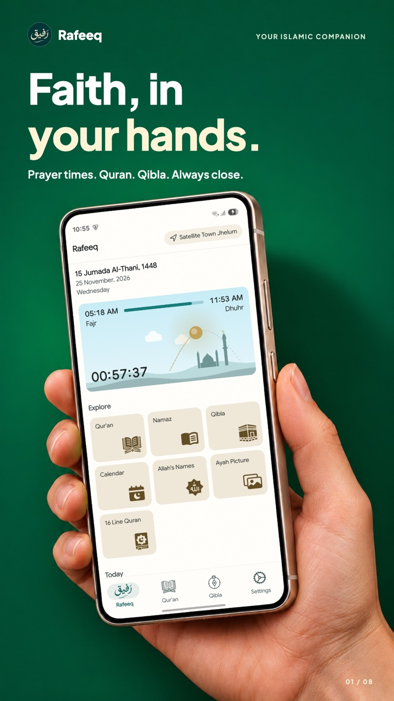
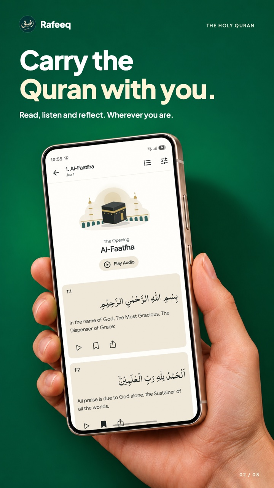
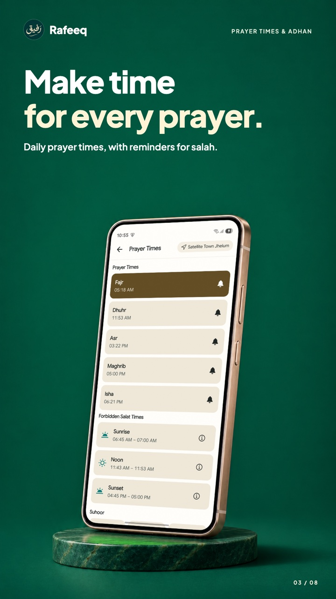
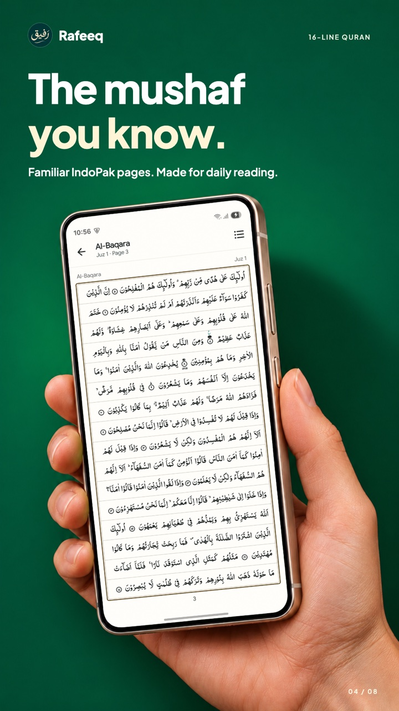
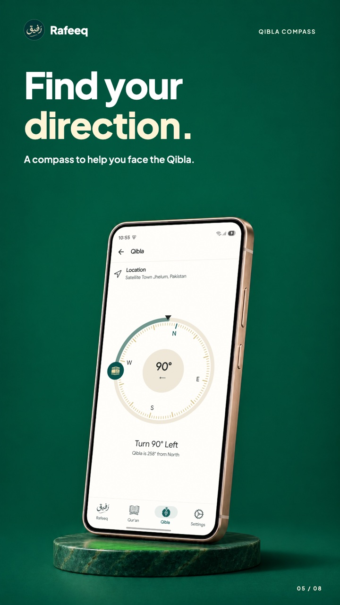
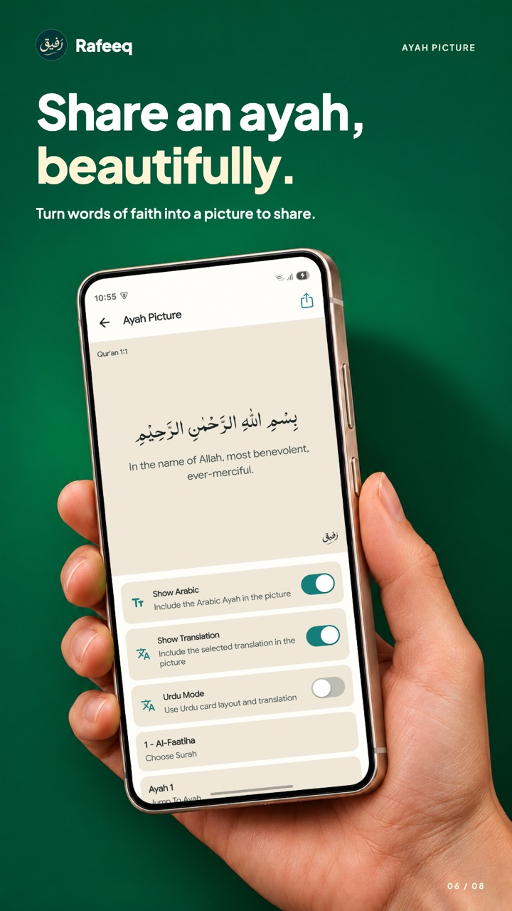
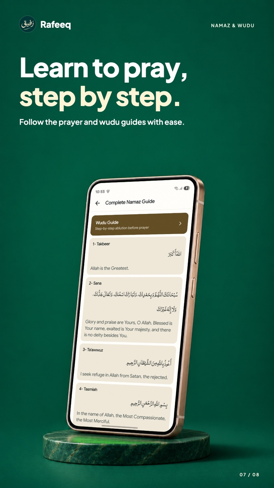
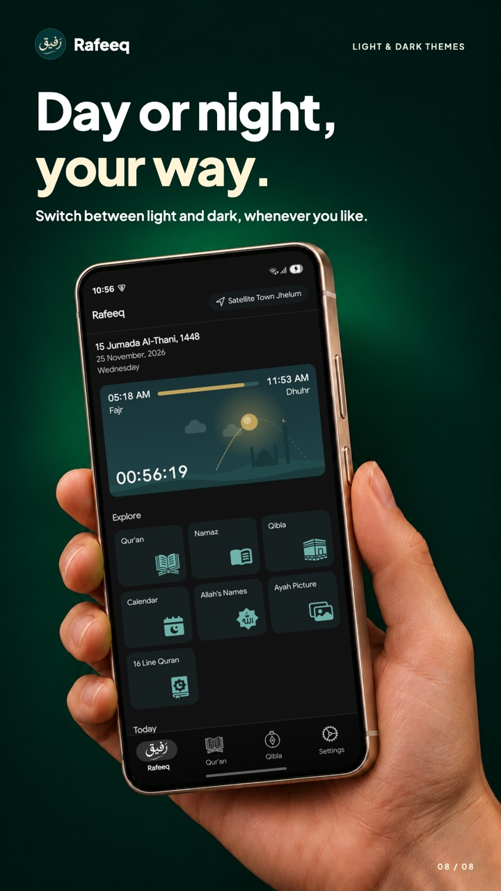

<div align="center">
  <picture>
    <source media="(prefers-color-scheme: dark)" srcset=".github/readme/calligraphy-dark.svg">
    
  </picture>

  <h3>Your Islamic Companion</h3>

  <p>
    <strong>Rafeeq</strong> is a free, open-source Islamic companion app that supports
    Muslims in their daily spiritual practice. No ads, in English and Urdu.
  </p>
  <p>
    <a href="https://play.google.com/store/apps/details?id=com.satechdev.rafeeqapp">
      
    </a>
  </p>
  <p>
    <a href="https://rafeeq.teamsazen.com">rafeeq.teamsazen.com</a>
  </p>
</div>

---

## Features

- **Quran** – Read every surah with English or Urdu translation, search, bookmark and share ayahs
- **16 Line IndoPak Quran** – The mushaf as printed in Pakistan and India; tap any ayah to hear it, highlighted as it plays
- **Recitations** – A choice of reciters, a mini-player, and playback that keeps going with the screen off
- **Prayer Times** – Location-based times with adhan notifications, forbidden times, Suhoor and Iftar
- **Qibla** – A live compass pointing towards the Kaaba, with gentle haptics
- **Hijri & Ramadan Calendars** – With adjustable Hijri date correction
- **Namaz & Wudu Guide** – Every step of salah with its meaning, plus daily duas
- **Asma ul Husna** – The 99 Names of Allah with meanings
- **Ayah Picture Maker** – Turn an ayah into a picture to save or send
- **English & Urdu** – Full localization with Urdu in Nastaleeq, plus light and dark themes

---

## Screenshots

From our [Google Play listing](https://play.google.com/store/apps/details?id=com.satechdev.rafeeqapp). Select any screenshot to view it full size.

<p align="center">
  <a href=".github/readme/screenshots/01-home.jpg"></a>
  <a href=".github/readme/screenshots/02-quran.jpg"></a>
  <a href=".github/readme/screenshots/03-prayer.jpg"></a>
  <a href=".github/readme/screenshots/04-mushaf.jpg"></a>
</p>

<details>
  <summary>More screenshots</summary>

<p align="center">
  <a href=".github/readme/screenshots/05-qibla.jpg"></a>
  <a href=".github/readme/screenshots/06-ayah.jpg"></a>
  <a href=".github/readme/screenshots/07-namaz.jpg"></a>
  <a href=".github/readme/screenshots/08-theme.jpg"></a>
</p>

</details>

---

## Changelog

See [CHANGELOG.md](CHANGELOG.md) for recorded Android build notes, and [`docs/release/`](docs/release) for the Play Store notes of each 2.x release.

---

## Tech Stack

Rafeeq 2.0 and later is a native Android app in [`native/`](native). The original Flutter app (`lib/`, `android/`, `ios/`) stays in the repository next to it; see [`docs/native-plan.md`](docs/native-plan.md) for how the two relate.

**Android app (`native/`, on Google Play)**

- **Language & UI:** Kotlin, Jetpack Compose (no Material; the app draws its own controls)
- **Audio:** Media3 ExoPlayer and MediaSession, for recitation in the background and on the lock screen
- **Location:** Google Play services location
- **Monitoring:** Firebase Analytics and Crashlytics (release builds only)
- **Updates:** Google Play in-app updates

**Flutter app (`lib/`)**

- **Framework:** Flutter (Dart ≥ 3.10), Riverpod + Hooks
- **Local Storage:** SQLite (sqflite) and Shared Preferences
- **Audio:** just_audio
- **Prayer Times & Location:** adhan, Geolocator
- **Updates:** Shorebird code push

Both apps share the Quran text, fonts and legal pages in [`assets/`](assets).

---

## Getting Started

### Fonts

The 16 Line Quran is drawn with QuranWBW's IndoPak font, AlQuran Neo v5.x. Rafeeq has their written permission to use it, but not to share it, so it is not in this repository. Any font at its path lets the apps build; the Quran text only shows correctly with the real one, which you can request from QuranWBW (quranwbw@gmail.com) for your own project:

```bash
cp assets/fonts/JameelNooriNastaleeq.ttf assets/fonts/AlQuranNeo5x3-Arabic.ttf
```

### Android app (native)

Firebase is used only for Analytics and Crashlytics, and only in release builds, so debug builds run without any config. For a release build, create your own Firebase project, register `com.satechdev.rafeeqapp` and place its `google-services.json` at `native/app/src/release/google-services.json` (not committed).

```bash
cd native
./gradlew installDebug   # build and install on a connected device
./gradlew test           # unit tests
```

### Flutter app

The Firebase config files are not committed. Register the Android app (`com.satechdev.rafeeqapp`, plus `com.satechdev.rafeeqapp.debug` for debug builds) and the iOS app (`com.satechdev.rafeeqapp`) in your own Firebase project, then place the downloaded files at:

- `android/app/google-services.json`
- `ios/Runner/GoogleService-Info.plist`

```bash
flutter pub get
flutter run
```

Before opening a pull request that touches the Flutter app, make sure both of these pass:

```bash
flutter analyze
flutter test
```

---

## Website

The landing page at [rafeeq.teamsazen.com](https://rafeeq.teamsazen.com) lives in [`website/`](website). It is a static [Astro](https://astro.build) site hosted on Cloudflare Pages, and every push to `main` that changes `website/` deploys it through GitHub Actions.

```bash
cd website
npm install
npm run dev      # local preview at http://localhost:4321
npm run images   # rebuild the page's screenshots from website/screens/
```

---

## License & Branding

The source code is licensed under [MIT](LICENSE): use, modify, and share all or part of it, including commercially, while keeping the required copyright and license notices.

The **Rafeeq name, logos, app icons, and branded artwork are not licensed for reuse as your own app branding**. Published forks should use their own identity unless permission is granted. See the [branding policy](BRANDING.md); third-party content retains its own terms.

Rafeeq is fully free. To improve the official app under the Rafeeq name, contributions here are always welcome.

---

## Contributing

Contributions are welcome. Open an issue to discuss bigger changes first, then send a pull request from a feature branch. The maintainers review every pull request before it is merged.

---

<div align="center">
  <p>Made with ❤️ for the Ummah</p>
  <p>Powered by <a href="https://github.com/teamsazen"><ins>Sazen</ins></a></p>
</div>
